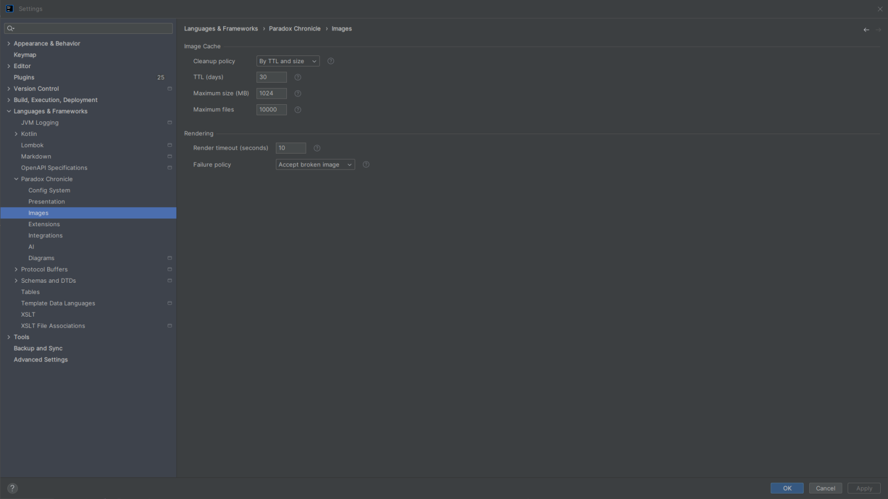
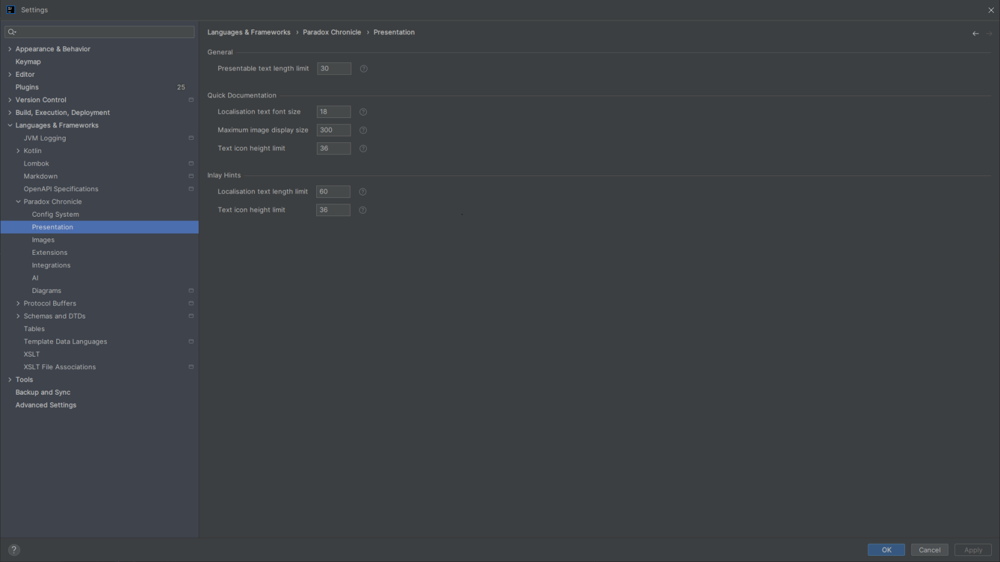
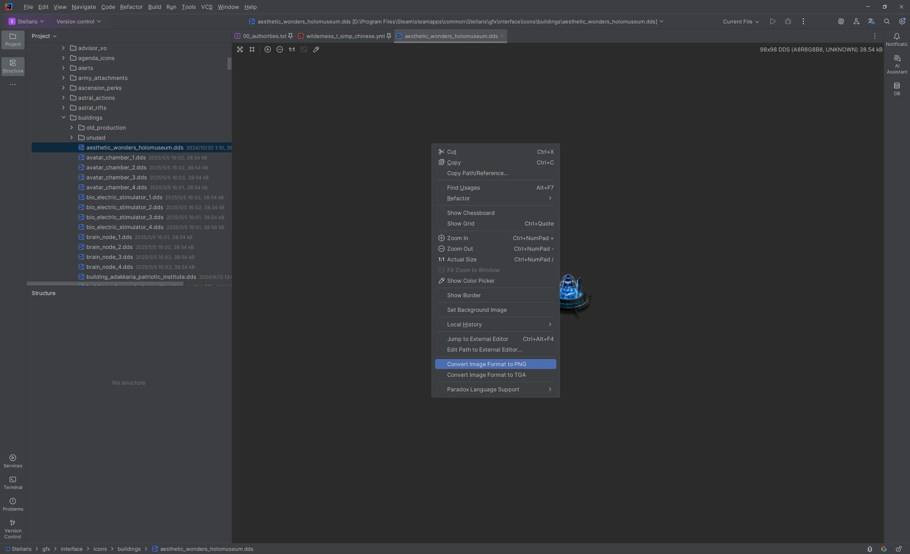
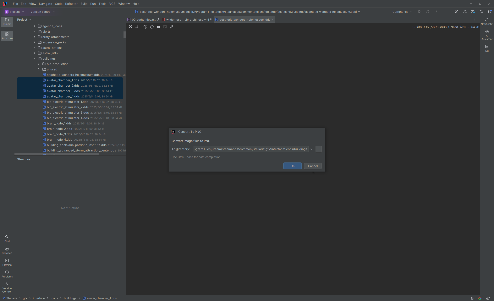

# Image Support

The plugin provides image reading, preview, rendering, and format conversion for Paradox game mods, and applies these capabilities to quick documentation, inlay hints, editor preview, image conversion actions, and other language features.

## Settings Page {#settings-page}

<!-- @see icu.windea.pls.base.settings.ChronicleImageSettingsConfigurable -->
<!-- @see icu.windea.pls.base.settings.ChroniclePresentationSettingsConfigurable -->

In the IDE settings page, go to `Languages & Frameworks > Paradox Chronicle > Images` to open the image processing settings page.

Here you can configure the image cache cleanup policy, cache size limits, render failure policy, and image materialization timeout.

Go to `Languages & Frameworks > Paradox Chronicle > Presentation` to open the presentation settings page, which contains text, image, and text icon limits for quick documentation and inlay hints.

## Supported Formats {#supported-formats}

<!-- @see icu.windea.pls.images.dds.DdsFileType -->
<!-- @see icu.windea.pls.images.tga.TgaFileType -->
<!-- @see org.intellij.images.fileTypes.impl.ImageFileType -->

- Standard image formats: PNG, JPEG, GIF, and other formats supported by the IDE and `ImageIO`.
- Extended image formats: DDS and TGA.

The plugin does not change how the IDE recognizes ordinary image files. It only adds DDS/TGA reading, preview, and rendering support.

## Editor Preview {#image-preview}

<!-- @see icu.windea.pls.images.editor.ImageFileEditorProvider -->
<!-- @see icu.windea.pls.images.editor.ImageFileEditor -->
<!-- @see icu.windea.pls.images.actions.EditExternalImageEditorAction -->

Open an image file in the editor to preview it. DDS and TGA images are loaded through the image reading support provided by the plugin.

You can also use `Jump to External Editor` in the context menu to open the image in the image editor associated with your operating system.

<!--  -->
<!--  -->

> [!tip]
> If DDS/TGA images cannot be rendered properly, check the image tool integration and cache settings. See [Integrations](integrations.md#image-tools) for external tool configuration.

## Images in Quick Documentation {#quick-doc}

<!-- @see icu.windea.pls.lang.codeInsight.documentation.ParadoxDocumentationTarget -->
<!-- @see icu.windea.pls.lang.codeInsight.documentation.CwtDocumentationTarget -->
<!-- @see icu.windea.pls.lang.util.renderers.ParadoxLocalisationTextQuickDocRenderer -->
<!-- @see icu.windea.pls.images.ImageRenderService.applyImageScaling -->

Images in quick documentation are loaded through a render session:

- Building the documentation only resolves image sources and rendering requests; it does not perform image IO.
- After the documentation content is built, image rendering and decoding are awaited in the background.
- This avoids executing command-line tools or image rendering in a readAction.

For **text icons** in localisation text:

- Images with a height no greater than `quickDocTextIconHeightLimit` are treated as text icons.
- They are scaled to the actual documentation text height for better visual alignment.
- Images taller than this limit are treated as ordinary images and keep their original size, avoiding forced shrinking of large images embedded in localisation text.

The maximum display size of images in quick documentation can be configured with `quickDocMaxImageDisplaySize`.

<!--  -->
<!--  -->

## Images in Inlay Hints {#inlay-hints}

<!-- @see icu.windea.pls.lang.codeInsight.hints.AsyncIconPresentation -->
<!-- @see icu.windea.pls.lang.codeInsight.hints.script.ParadoxModifierIconHintsProvider -->
<!-- @see icu.windea.pls.lang.codeInsight.hints.localisation.ParadoxLocalisationIconHintsProvider -->

Text icons in inlay hints are materialized asynchronously:

- Collecting hints only creates a placeholder presentation; image pixels are not read.
- Images are read, rendered, and decoded in a background coroutine.
- After completion, the placeholder presentation is updated to the actual icon on the EDT.
- `CachedImageIcon` is not lazily loaded on the EDT or in a readAction.

Icons taller than `inlayTextIconHeightLimit` are not rendered.

<!--  -->
<!--  -->

## Image Format Conversion {#convert-image-format}

<!-- @see icu.windea.pls.images.actions.ConvertImageFormatAction -->
<!-- @see icu.windea.pls.images.actions.ConvertImageFormatActions -->
<!-- @see icu.windea.pls.images.ImageService.convertImageFormat -->

The plugin provides the following image format conversion actions:

- Convert selected images to PNG, DDS, or TGA.
- Select multiple images in the project view for batch conversion.
- Confirm the target file name and target directory before conversion.
- Choose to skip or overwrite existing target files.

<!-- batch -->

Image conversion uses the built-in TwelveMonkeys ImageIO implementation first. If the built-in implementation cannot complete the conversion, the configured external image tool may be used as a fallback.

> [!warning]
> TwelveMonkeys ImageIO has format limitations, such as not supporting writing DDS or certain newer DDS extension formats.
> If you need to convert these formats, configure an external image tool. See [Integrations](integrations.md#image-tools).

## Implementation Notes {#implementation}

### Image Reading and Rendering

<!-- @see icu.windea.pls.images.ImageContext -->
<!-- @see icu.windea.pls.images.ImageService -->
<!-- @see icu.windea.pls.images.ImageIoService -->
<!-- @see icu.windea.pls.images.ImageMetadataService -->

Image processing is based on [TwelveMonkeys ImageIO](https://github.com/haraldk/TwelveMonkeys) and IntelliJ Platform image support:

- Standard image formats are handled by `ImageIO` and IDE image support.
- DDS/TGA are handled by the `ImageReader`/`ImageWriter` SPIs registered by the plugin.
- Image metadata reading, rendering, and decoding are coordinated by `ImageRenderService`.

### External Image Tools

<!-- @see icu.windea.pls.integrations.images.ImageToolProvider -->
<!-- @see icu.windea.pls.integrations.images.ImageToolService -->

When the built-in implementation cannot handle a specific image or format, external image tools (such as Texconv or ImageMagick) can be enabled.

See [Integrations](integrations.md#image-tools) for external tool configuration, downloads, and limitations. This page does not cover command-line details.

### Cache

<!-- @see icu.windea.pls.images.ImageRenderService -->
<!-- @see icu.windea.pls.images.ImageCacheCleaner -->

Rendered and sliced PNG images are cached under `~/.windea/chronicle/images`.

You can configure the following in the image settings page:

- Cache cleanup policy: none, by TTL, by size, or by TTL and size;
- TTL (days);
- Maximum cache size (MB);
- Maximum number of cache files.

### Timeout, Cancellation, and Failure Policy

<!-- @see icu.windea.pls.base.settings.ChronicleImageSettings -->
<!-- @see icu.windea.pls.model.policies.ImageRenderFailurePolicy -->

- Image materialization is limited by `renderTimeoutSeconds`.
- Image reading, copying, and writing check for cancellation when the byte threshold is reached.
- External tool commands support timeout and cancellation.
- When rendering fails, you can choose to:
  - accept the broken image;
  - remove the image;
  - use a placeholder.

## Related Settings

| Setting | Description |
|---|---|
| `cacheCleanupPolicy` | Image cache cleanup policy |
| `cacheTtlDays` | Cache TTL (days) |
| `cacheMaxSizeMb` | Maximum cache size (MB) |
| `cacheMaxFiles` | Maximum number of cache files |
| `renderTimeoutSeconds` | Timeout for materializing one image |
| `renderFailurePolicy` | Image render failure policy |
| `presentableTextLengthLimit` | Presentable text length limit |
| `quickDocLocalisationTextFontSize` | Fallback font size for localisation text in quick documentation |
| `quickDocMaxImageDisplaySize` | Maximum image display size in quick documentation |
| `quickDocTextIconHeightLimit` | Text icon height limit in quick documentation |
| `inlayLocalisationTextLengthLimit` | Localisation text length limit in inlay hints |
| `inlayTextIconHeightLimit` | Text icon height limit in inlay hints |

<!-- Reserved image placeholders for future documentation:

-->

<!-- @see icu.windea.pls.images.ImageRenderSession -->
<!-- @see icu.windea.pls.lang.resolve.ParadoxImageService -->
<!-- @see icu.windea.pls.lang.resolve.ParadoxImageResolveResult -->
