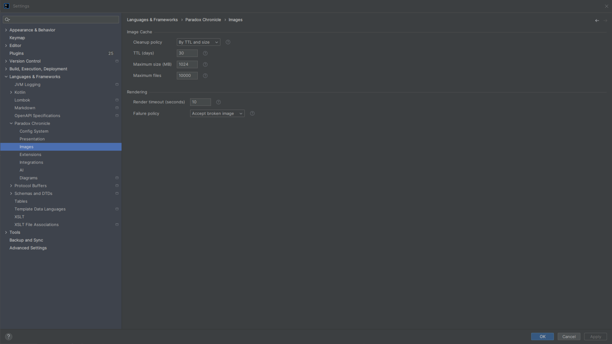
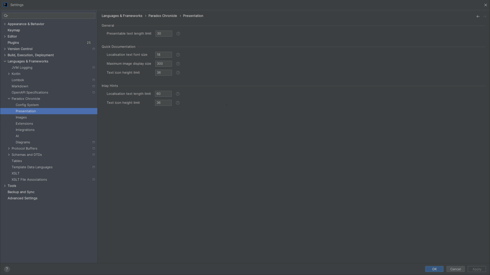
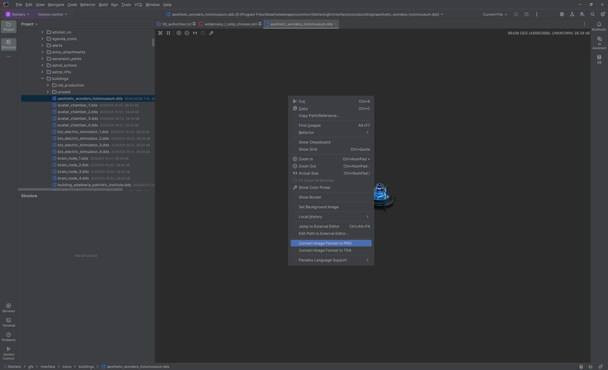
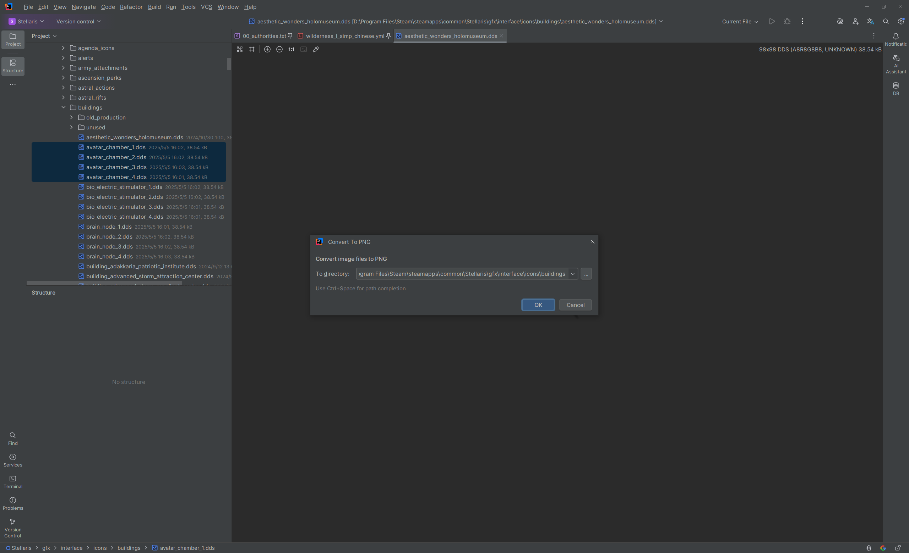

# 图片支持

插件为 Paradox 游戏模组中的图片提供了读取、预览、渲染和格式转换支持，并将其应用到快速文档、内嵌提示、编辑器预览和图片转换动作等语言功能中。

## 设置页面 {#settings-page}

<!-- @see icu.windea.pls.base.settings.ChronicleImageSettingsConfigurable -->
<!-- @see icu.windea.pls.base.settings.ChroniclePresentationSettingsConfigurable -->

在 IDE 的设置页面中，点击 `语言与框架 > Paradox Chronicle > 图片`，可以打开图片处理的设置页面。

可以在这里配置图片缓存清理策略、缓存大小限制、渲染失败策略和图片物化超时。

点击 `语言与框架 > Paradox Chronicle > 展示`，可以打开展示阈值设置页面，其中包含快速文档和内嵌提示相关的文本、图片和文本图标限制。

## 支持的图片格式 {#supported-formats}

<!-- @see icu.windea.pls.images.dds.DdsFileType -->
<!-- @see icu.windea.pls.images.tga.TgaFileType -->
<!-- @see org.intellij.images.fileTypes.impl.ImageFileType -->

- 标准图片格式：包括 PNG、JPEG、GIF 等由 IDE 和 `ImageIO` 支持的格式。
- 扩展图片格式：DDS 和 TGA。

插件不会改变 IDE 对普通图片文件的识别，只是额外提供对 DDS/TGA 的读取、预览和渲染能力。

## 编辑器预览 {#image-preview}

<!-- @see icu.windea.pls.images.editor.ImageFileEditorProvider -->
<!-- @see icu.windea.pls.images.editor.ImageFileEditor -->
<!-- @see icu.windea.pls.images.actions.EditExternalImageEditorAction -->

在编辑器中打开图片文件即可进行预览。DDS 和 TGA 图片会通过插件提供的图片读取支持加载。

也可以在右键菜单中使用 `Jump to External Editor` 转到系统关联的外部图片编辑器。

<!--  -->
<!--  -->

> [!tip]
> 如果 DDS/TGA 图片无法正常渲染，请检查图片工具集成和缓存设置。外部工具相关配置参见[集成](integrations.md#image-tools)。

## 快速文档中的图片 {#quick-doc}

<!-- @see icu.windea.pls.lang.codeInsight.documentation.ParadoxDocumentationTarget -->
<!-- @see icu.windea.pls.lang.codeInsight.documentation.CwtDocumentationTarget -->
<!-- @see icu.windea.pls.lang.util.renderers.ParadoxLocalisationTextQuickDocRenderer -->
<!-- @see icu.windea.pls.images.ImageRenderService.applyImageScaling -->

快速文档中的图片会通过渲染会话延迟加载：

- 构建文档时只解析图片来源和渲染请求，不执行图片 IO。
- 文档内容构建完成后，再在后台等待图片渲染和解码。
- 这样不会在 readAction 中执行命令行或图片渲染。

对于本地化文本中的**文本图标**：

- 高度不超过 `quickDocTextIconHeightLimit` 的图片会被视为文本图标。
- 它们会按照文档实际文本高度进行缩放，以获得和文本更协调的显示效果。
- 高度超过该限制的图片视为普通图片，保持原始尺寸，避免把本地化文本中的大图片强制缩小成小图标。

快速文档图片的最大显示尺寸可以通过 `quickDocMaxImageDisplaySize` 配置。

<!--  -->
<!--  -->

## 内嵌提示中的图片 {#inlay-hints}

<!-- @see icu.windea.pls.lang.codeInsight.hints.AsyncIconPresentation -->
<!-- @see icu.windea.pls.lang.codeInsight.hints.script.ParadoxModifierIconHintsProvider -->
<!-- @see icu.windea.pls.lang.codeInsight.hints.localisation.ParadoxLocalisationIconHintsProvider -->

内嵌提示中的文本图标使用异步物化：

- 收集提示时只创建占位 presentation，不读取图片像素。
- 图片在后台协程中读取 metadata、渲染和解码。
- 完成后在 EDT 更新占位 presentation 为实际图标。
- 不会在 EDT 或 readAction 中懒加载 `CachedImageIcon`。

高度超过 `inlayTextIconHeightLimit` 的图标不会被渲染。

<!--  -->
<!--  -->

## 图片格式转换 {#convert-image-format}

<!-- @see icu.windea.pls.images.actions.ConvertImageFormatAction -->
<!-- @see icu.windea.pls.images.actions.ConvertImageFormatActions -->
<!-- @see icu.windea.pls.images.ImageService.convertImageFormat -->

插件提供以下图片格式转换动作：

- 将选中的图片转换为 PNG、DDS 或 TGA。
- 在项目视图中选择多个图片进行批量转换。
- 在转换前确认目标文件名和目标目录。
- 对已存在的目标文件提供跳过、覆盖等选择。

<!-- batch -->

图片转换会优先使用内置的 TwelveMonkeys ImageIO 实现；如果内置实现无法完成转换，则可能回退到配置的外部图片工具。

> [!warning]
> TwelveMonkeys ImageIO 存在格式限制，例如不支持写入 DDS，或不支持部分新版 DDS 扩展格式。
> 如果需要转换这些格式，建议配置外部图片工具。参见[集成](integrations.md#image-tools)。

## 实现说明 {#implementation}

### 图片读取与渲染

<!-- @see icu.windea.pls.images.ImageContext -->
<!-- @see icu.windea.pls.images.ImageService -->
<!-- @see icu.windea.pls.images.ImageIoService -->
<!-- @see icu.windea.pls.images.ImageMetadataService -->

图片底层基于 [TwelveMonkeys ImageIO](https://github.com/haraldk/TwelveMonkeys) 和 IntelliJ Platform 的图片支持：

- 标准图片格式由 `ImageIO` 和 IDE 图片支持处理。
- DDS/TGA 通过插件注册的 `ImageReader`/`ImageWriter` SPI 处理。
- 图片元数据读取、渲染和解码由 `ImageRenderService` 统一协调。

### 外部图片工具

<!-- @see icu.windea.pls.integrations.images.ImageToolProvider -->
<!-- @see icu.windea.pls.integrations.images.ImageToolService -->

当内置实现无法处理某个图片或格式时，可以启用外部图片工具（例如 Texconv、ImageMagick）。

外部工具的具体配置、下载和限制参见[集成](integrations.md#image-tools)。本文不展开外部工具的命令行细节。

### 缓存

<!-- @see icu.windea.pls.images.ImageRenderService -->
<!-- @see icu.windea.pls.images.ImageCacheCleaner -->

渲染和切分得到的 PNG 图片会缓存到 `~/.windea/chronicle/images`。

可以在图片设置页面配置：

- 缓存清理策略：不清理、按 TTL、按大小、按 TTL 和大小；
- TTL（天）；
- 最大缓存大小（MB）；
- 最大缓存文件数量。

### 超时、取消与失败策略

<!-- @see icu.windea.pls.base.settings.ChronicleImageSettings -->
<!-- @see icu.windea.pls.model.policies.ImageRenderFailurePolicy -->

- 图片物化受 `renderTimeoutSeconds` 限制。
- 图片读取、复制和写入在达到字节阈值时会检查取消。
- 外部工具命令支持超时和取消。
- 渲染失败时可以按设置选择：
  - 接受损坏图片；
  - 移除图片；
  - 使用占位图。

## 相关设置

| 设置 | 说明 |
|---|---|
| `cacheCleanupPolicy` | 图片缓存清理策略 |
| `cacheTtlDays` | 缓存 TTL（天） |
| `cacheMaxSizeMb` | 最大缓存大小（MB） |
| `cacheMaxFiles` | 最大缓存文件数量 |
| `renderTimeoutSeconds` | 单次图片物化超时 |
| `renderFailurePolicy` | 图片渲染失败策略 |
| `presentableTextLengthLimit` | 展示文本长度限制 |
| `quickDocLocalisationTextFontSize` | 快速文档本地化文本字体回退值 |
| `quickDocMaxImageDisplaySize` | 快速文档图片最大显示尺寸 |
| `quickDocTextIconHeightLimit` | 快速文档文本图标高度限制 |
| `inlayLocalisationTextLengthLimit` | 内嵌提示本地化文本长度限制 |
| `inlayTextIconHeightLimit` | 内嵌提示文本图标高度限制 |

<!-- 以下图片为后续文档补充预留：

-->

<!-- @see icu.windea.pls.images.ImageRenderSession -->
<!-- @see icu.windea.pls.lang.resolve.ParadoxImageService -->
<!-- @see icu.windea.pls.lang.resolve.ParadoxImageResolveResult -->
